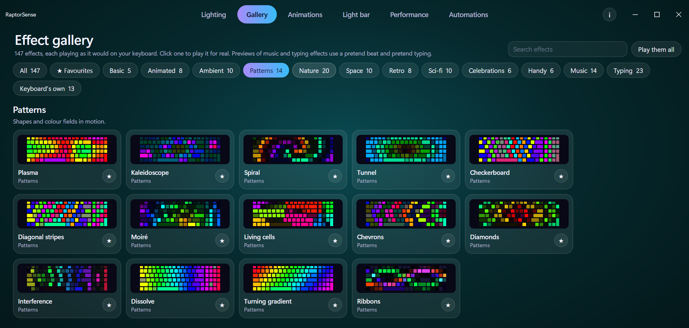
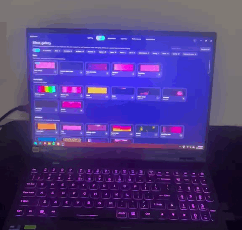
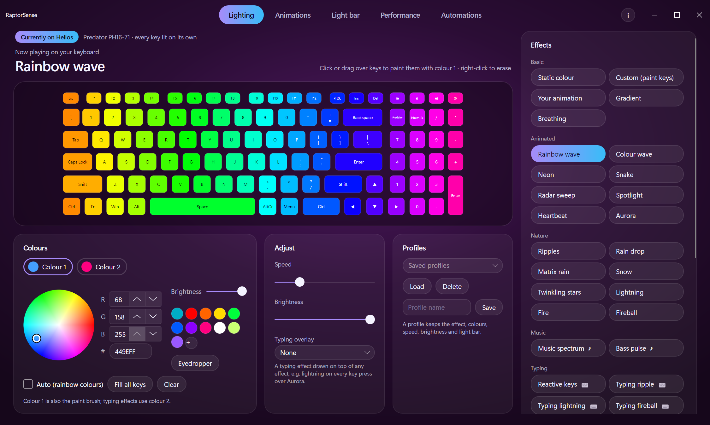
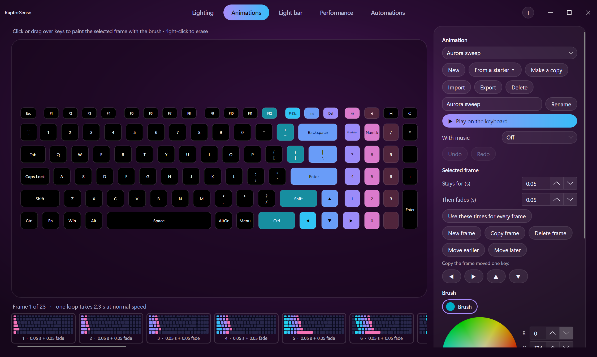

<div align="center">

# RaptorSense

**A free, open-source alternative to PredatorSense and NitroSense for Acer Predator and Nitro laptops.**<br>
Up to 147 keyboard lighting effects, your own animations, lighting that follows your music and your typing,<br>
plus fan and power control. No account, no telemetry.

[](https://github.com/aaronparayil/RaptorSense/releases/latest)
[](https://github.com/aaronparayil/RaptorSense/releases)
[](LICENSE)


[**Download**](https://github.com/aaronparayil/RaptorSense/releases/latest) ·
[Where it stands](#where-it-stands) ·
[Will it work on my laptop?](#will-it-work-on-my-laptop) ·
[Report your laptop](https://github.com/aaronparayil/RaptorSense/issues/new?template=laptop-report.yml) ·
[Install](#install) ·
[Features](#features) ·
[Privacy](#privacy) ·
[Build from source](#build-from-source)



</div>

> Unofficial. Not affiliated with or endorsed by Acer. "Predator", "Nitro", "PredatorSense" and "NitroSense" are
> Acer trademarks, used here only to describe compatibility.

Created by [aaronparayil](https://github.com/aaronparayil). Free and open source, forever. Built with the help of
[Claude Code](https://claude.com/claude-code), and tested on real laptops.

**Before you download:** the app isn't code-signed, so Windows may warn "Windows protected your PC" the first time
(choose **More info**, then **Run anyway**). Each release lists the zip's SHA-256 so you can check it, and the code is
all here to read or [build yourself](#build-from-source). Tested on the **Predator Helios 16 PH16-71** and the
**Nitro 5 AN515-57**; on another model, please [tell us how it went](https://github.com/aaronparayil/RaptorSense/issues/new?template=laptop-report.yml).

## Where it stands

The current release is **1.8.7**, for Windows. One download works on both tested laptops: the app reads the laptop's
model when it starts and shows what works on it.

| | Predator Helios 16 PH16-71 | Nitro 5 AN515-57 |
|---|---|---|
| Keyboard lighting | Every key on its own, 60 fps, no admin rights | Four zones, about ten changes a second; needs fan control installed |
| Effects | 96, plus 14 music and 23 typing effects, and the keyboard's 13 built-in ones, all in a gallery of live previews | 16 made for four zones (2 follow music, 4 react to typing), and the keyboard's 5 built-in ones |
| Static colour, painting, your own animations | Works, key by key | Works, zone by zone: each zone shows the average of its keys |
| Fans (Auto, Max, Custom) and temperatures | Works | Works |
| Power modes | Works | Not offered yet: not checked on this model |
| Rear light bar | Works | The laptop has none |
| PREDATOR key and Fn brightness keys | Works | Not supported yet |

**On other Acer laptops:** per-key lighting works only if the keyboard is one of the known ones, and fans and power
are read-only until the model has been checked. See [Will it work on my laptop?](#will-it-work-on-my-laptop)

**Linux:** a first [preview to test](https://github.com/aaronparayil/RaptorSense/releases/tag/linux-preview-1) is up, separate from the
Windows download. It lights the Helios's per-key keyboard, but that has **not driven a real keyboard yet**, so testers
are wanted: if you run Linux on a Predator with keyboard `04F2:0117`, `011A` or `0119`, please try it and
[send a report](https://github.com/aaronparayil/RaptorSense/issues/new?template=linux-test.yml), whether it worked or not.
Music and typing effects, fans, power and automations are still to come on Linux. The work is on the
[`linux` branch](https://github.com/aaronparayil/RaptorSense/tree/linux#linux).

## What you get

- **Two laptops, one download.** A Helios 16 with a per-key keyboard and a Nitro 5 with a 4-zone one, each seeing its
  own controls.
- **Lighting that follows the real keys.** 147 effects: 96 animated and static ones, 14 that move to your music, 23 that
  react to typing and the keyboard's own 13, all drawn on a live preview of your keyboard at 60 fps. Paint single keys by hand, pick two colours or
  let it run a rainbow.
- **Your own animations.** Paint frames, set how long each one stays and fades, and play the loop on the keyboard.
  Start from a ready-made one, undo freely, and share animations as files. An animation can follow your music too:
  step on the beat, speed up when it gets loud, or pulse with the bass.
- **Fans and power.** Power profiles, fan speeds (Auto, Max or your own), live temperatures, the rear light bar,
  and battery cycles and health.
- **The keyboard's own keys.** The PREDATOR key opens RaptorSense, and Fn+F11 / Fn+F12 dim and brighten the keys.
- **Automations.** Rules such as "while this game is open, use my gaming profile, Turbo and Max fans", "while
  sound is playing, use my music profile" or "lights off after five minutes untouched", which put everything back
  when they end.
- **Light on the laptop.** No admin rights for lighting, no accounts, no telemetry. It sits in the tray and stops
  drawing its window while that is closed. It doesn't use the graphics card, and needs about 35 MB of memory when
  it starts in the tray (about 70 MB once the window has been opened).

## See it in action



Recorded on an earlier version: the effects are the same, the window has a new look since.



## Will it work on my laptop?

Tested on two machines so far: **Predator Helios 16 PH16-71** (BIOS V1.18, per-key keyboard `04F2:0117`) and
**Nitro 5 AN515-57** (BIOS V1.22, 4-zone keyboard). One download works on both: the app reads the laptop's model
when it starts and shows what works on it. Windows only for now; Linux is [in progress](#where-it-stands).

- **Per-key lighting** looks for keyboards `04F2:0117`, `011A` and `0119`. If yours isn't one of these and the laptop
  isn't the Nitro below, the app says "Keyboard not found" and does nothing. A similar keyboard may have its keys
  mapped differently.
- **Fans, power modes and the light bar** use Acer's gaming firmware interface, and RaptorSense only changes them
  on models where they have been tested: all three on the PH16-71, the fans on the AN515-57. Firmware differs between
  laptops, so on any other model it shows temperatures and fan speeds but changes nothing, until that model has been
  checked. The readings may be off there too.
- **Nitro 5 AN515-57** (BIOS V1.22): its keyboard lights in four zones through the same firmware interface, and the
  same app drives it. It picks the laptop by its model: the Lighting tab says **Currently on Nitro** (or **Currently on
  Helios**) and draws that keyboard. The Nitro has its own list of 16 effects made for four zones, among them colour
  drift, scanner, lava lamp, ocean swell, music zones and typing speed; the Helios's per-key effects are not offered
  there. Static colour, painting and your own animations work on both, with each zone showing the average of its
  keys, up to about ten times a second. A **Keyboard zones** tab sets a colour per zone or one of the keyboard's own
  effects. All of this goes through the helper, so on the Nitro lighting needs fan control installed. Fan control (Auto, Max, Custom, with the same safety rules) was checked on it too; power modes haven't
  been, so they aren't shown there. The Nitro has no light bar, so there is no Light bar tab.

RaptorSense comes with no warranty (see the [licence](LICENSE)). If you try it on another model, please
[fill in a laptop report](https://github.com/aaronparayil/RaptorSense/issues/new?template=laptop-report.yml) and say how it went, whether it worked or not.
The [probe](#other-laptops) helps add new models.

## Install

1. Download the zip from [Releases](https://github.com/aaronparayil/RaptorSense/releases/latest). You don't need to install .NET.
2. Extract it to a folder you'll keep, such as `Documents\RaptorSense`.
3. Run `RaptorSense.exe`. Close PredatorSense first, because both try to drive the keyboard.

The download isn't code-signed, so Windows may show "Windows protected your PC". Choose **More info**, then **Run anyway**.
If you'd rather not trust a download, [build it yourself](#build-from-source).

**For fan and power control**, open the **Performance** tab, press **Install fan control** under Fans and accept
the administrator prompt. (Double-clicking `Install fan control.cmd` does the same.) On the Helios, lighting works
without this. On the Nitro the keyboard is lit through it, so install it there first.
See [Fans and power modes](#fans-and-power-modes) for what it installs.

**To update:** quit RaptorSense from the tray, then extract the new zip over your old folder. Your profiles,
animations and rules are kept. If the Performance tab then shows **Update fan control**, press it: the new version
changed the helper too.

**To uninstall:**

1. If you installed fan control, double-click `Remove fan control.cmd`.
2. Turn off **Start with Windows** in the app if you turned it on.
3. Quit from the tray and delete the folder. Your profiles are in `%APPDATA%\RaptorSense`; delete that too if you don't want them.

## Features

| Feature | State |
|---|---|
| Per-key RGB at 60 fps, no admin rights | Works |
| 96 lighting effects using real key positions, in collections: Animated, Ambient (candlelight, tide, fireflies, lava lamp), Patterns (plasma, kaleidoscope, tunnel, moiré), Nature (ocean waves, waterfall, rainstorm, coral reef), Space (warp speed, galaxy, black hole, eclipse), Retro (Game of Life, falling blocks, paddle rally, snake hunt, sorting), Sci-fi (circuit board, hologram, DNA helix, terminal), Celebrations (fireworks, festive lights, diyas, colour festival) and Handy (clock, gaming keys, typing guide, focus timer, night light) | Works |
| 14 music effects: spectrum, bass pulse, VU meter, spectrogram, beat rings, music fire, disco floor, mood colour and more (listens to your PC's audio output, never the microphone) | Works |
| 23 typing effects: reactive keys, ripple, lightning, comet, rainbow keys, light trail, key fireworks, frost keys, paint as you type, electric arc, chain reaction and more | Works |
| Effect gallery: every effect playing at once on its own little keyboard, by collection, with search, favourites and **Play them all**, a showcase that plays each one on the keyboard in turn | Works |
| Typing overlay: layer a typing effect over another effect, such as lightning on key presses over Aurora | Works |
| The keyboard's 13 built-in effects, which keep running when RaptorSense is closed | Works |
| Key painting: click or drag keys in the preview, right-click to erase | Works |
| Animation builder: paint frames, set how long each stays and fades, and play your own key animations. Starter animations, undo, and import/export to share them | Works |
| Animations that follow the music: one frame per beat, faster when it's louder, or brighter with the bass | Works |
| Colour wheel with saved swatches and an eyedropper | Works |
| Profiles: save, load, delete; the app restores your last setup | Works |
| Live preview of the real key layout | Works |
| A choice of nine background colours for the window | Works |
| Tray icon: runs in the background, with profiles, pause and quit | Works |
| Start with Windows (no admin needed), starts hidden with your last setup | Works |
| Start-up light show: a few seconds of rainbow, strobes and flashes when RaptorSense starts | Works on both keyboards. **Off unless you switch it on** (Lighting tab), because it flashes |
| Nitro 5 AN515-57: 4-zone keyboard with a colour per zone, the keyboard's own effects, 16 zone effects, and fans | Works; needs fan control installed. At most ten changes a second, so it is less smooth than per-key |
| Power profiles, fans (Auto / Max / Custom) and live temperatures | Works; needs fan control installed (a button on the Performance tab). Changes nothing on models that haven't been tested |
| Rear light bar: a colour per zone, brightness, and its 6 built-in animations | Works; needs fan control installed. No live effects or music sync on it yet |
| Battery: charge cycles and health, from Windows' battery driver | Works |
| Automations: when an app is open, on battery or plugged in, while sound is playing, after some minutes untouched, or while the screen is off, switch the lighting profile, power mode and fans, then put them back | Works; power mode and fans need fan control installed. The screen-off rule has not been tried on a real screen yet |
| PREDATOR key opens the window; Fn+F11 / Fn+F12 change the brightness | Works |
| Linux | A [preview to test](https://github.com/aaronparayil/RaptorSense/releases/tag/linux-preview-1), built from the [`linux` branch](https://github.com/aaronparayil/RaptorSense/tree/linux#linux): it builds, starts and passes its tests on Linux. Keyboard lighting is written but not yet tried on a real keyboard, and testers are wanted |

## Lighting

The **Lighting** tab is the one in the picture at the top. The keyboard in the middle shows what the real one is
doing, and the name of the effect is above it.

- Pick an effect from the list on the right, grouped by collection, or search it by name. A ♪ marks the ones that
  follow your music, a ⌨ the ones that react to typing. Effects you star in the gallery are listed first.
- **Colours** has two colours, a wheel, saved swatches and an eyedropper that takes a colour from any key in the preview.
  Colour 1 is also the paint brush: click or drag over keys to paint them, right-click to erase.
- **Adjust** has speed, brightness and the typing overlay, which draws a typing effect on top of any other effect.
- **Profiles** save the effect, colours, speed, brightness and light bar under a name. The app also restores your
  last setup when it starts.

### Gallery

The **Gallery** tab shows every effect at once, each playing on its own little keyboard as it would on yours, in
your colours. Pick a collection along the top or search by name, and click any of them to play it on the keyboard.
The star adds it to your favourites, at the top of the Lighting tab's list. The previews of music and typing effects
use a pretend beat and pretend typing, so they move even when nothing is playing.

**Play them all** plays every effect in view on the real keyboard, one after another, for 5 to 30 seconds each:
**Keep this one** stops on the effect you like, **Stop** goes back to what was playing before. During the showcase,
typing effects get pretend typing and music effects follow the demo beat while your computer is quiet.

None of the effects flash: each is checked against the screen flash rule (no more than three flashes a second) at
normal and double speed. The previews move only while the Gallery tab is in sight, slow down when another window is
in front, and are let go of when the window closes.

The round **i** button at the top right opens a small panel with the keyboard connection, the frame rates, a choice
of background colours for the window, and the version. It also has a **Drawing** switch. RaptorSense draws its
window on the processor, which keeps memory low and leaves the graphics card alone; while the window is open with
an effect playing, that takes about 40% of one processor core on the Helios 16. Switching it on draws the window
with the graphics card: lighter on the processor and smoother on a very large screen, for about 100 MB more
memory. It changes the next time RaptorSense starts.

**Keys on the keyboard.** The **PREDATOR key** opens RaptorSense in front of whatever you're doing; pressed again
with the window in front, it puts it back in the tray. **Fn+F11** and **Fn+F12** make the keys dimmer and brighter
in the keyboard's own five steps, and the brightness slider follows. If PredatorSense is installed, the PREDATOR
key opens that as well.

Profiles are readable JSON files in
`%APPDATA%\RaptorSense\profiles`. Painted keys are stored by name (`"W": "FF0000"`), so profiles can be shared and
edited by hand.

Acer's lighting service, PredatorSense and Razer Chroma can also drive the keyboard. RaptorSense re-sends its
frame every second, so it wins, but close PredatorSense while you use it.

## Animations



The **Animations** tab builds your own key animations. An animation is a row of frames: paint each one on the
keyboard, then set how long it stays and how long it takes to fade into the next. The last frame fades back into
the first, so it loops.

- While you edit, the keyboard shows the frame you're painting. **Play on the keyboard** runs the whole loop.
- **With music** makes the animation follow whatever the laptop is playing. **Step on the beat** moves one frame on
  every beat of the bass, so "Stays for" isn't used and "Then fades" is how long each change takes. **Faster when
  louder** plays the loop slowly when it's quiet and speeds it up with the music. **Pulse with the bass** keeps the
  animation's own times and makes it brighter with the bass. The choice is saved in the animation, so it travels
  with an exported file. RaptorSense listens to your PC's audio output, never the microphone, and only while a
  music effect or such an animation is in use.
- The arrow buttons copy the frame moved one key left, right, up or down. Paint a column once and press ▶ a few
  times to make it slide across the keyboard.
- **From a starter** gives you a ready-made animation in the brush colour (sweep, pulse, ripple, waterfall or
  rainbow drift) to change into your own. **Use the keyboard's current lighting** copies what the keyboard shows
  right now into the frame.
- **Undo** and **Redo** (Ctrl+Z, Ctrl+Y) step back through your changes. A whole drag of the brush is one step.
- **Export** saves an animation as a file to share, and **Import** adds files other people shared. An import never
  replaces an animation you already have: one with the same name gets a number.
- Every change saves by itself. Pick **Your animation** on the Lighting tab to use one any time; the speed and
  brightness there apply to it, a typing overlay plays on top, and a saved profile remembers which animation it uses.
- Playing costs about as much as a painted layout: one blend of 128 colours per frame, and nothing is sent to the
  keyboard while a frame holds still.

Animations are readable JSON files in `%APPDATA%\RaptorSense\animations`, with keys stored by name like profiles.
They hold only colours and times (plus one word, `beat`, `speed` or `pulse`, if the animation follows the music),
never code, so a shared animation can't do anything else. On import, anything
RaptorSense doesn't recognise is dropped.

## Automations

The **Automations** tab holds rules such as "while VALORANT is open, use my gaming profile, Turbo and Max fans" or
"on battery, use Eco and a dim profile".

A rule can start when:

- **An app is open**, **On battery** or **Plugged in**.
- **Sound is playing.** Pair it with a profile that uses a music effect, and the keyboard dances while something
  plays and goes back to your usual lighting when it stops. Sound counts as playing after three seconds of it, so
  a notification chime doesn't count, and as stopped after fifteen seconds of silence, so the gap between two songs
  doesn't end it. The volume setting makes no difference.
- **Nothing is touched for** a number of minutes: no key, mouse or touchpad use. A film you are only watching
  counts as untouched. The rule ends within a quarter of a second of you coming back.
- **The screen is off**, which follows the screen timeout you set in Windows.

Under **Lighting profile**, **Lights off** turns every key dark without you having to save a profile for it. It
leaves the brightness setting and the light bar alone; to switch the light bar off too, save a profile with the
bar off and pick that instead.

- When a rule ends, everything goes back to how it was before it started, including anything you changed by hand in between.
- If two rules set the same thing, the higher one in the list wins. Each setting is decided on its own, so a lower rule can still set what the higher one leaves alone.
- An app counts as open from when it is running until it closes, so switching to another window doesn't end the rule.
- Quitting RaptorSense also ends the rules and puts the power mode and fans back. If it crashes, or Windows shuts down before that finishes, they can stay as the rule set them.
- The fan safety rules still apply: everything goes through the helper.

Rules are saved in `%APPDATA%\RaptorSense\automations.json`.

## Fans and power modes

Windows lets only administrators change fans, power profiles and the rear light bar, so these go through a small
helper service, `RaptorSense.Helper`. The app itself runs without admin rights and talks to the helper over a local pipe.
The helper accepts only a fixed set of commands (read sensors, set a power profile, set the fan mode, set the light bar,
set the Nitro's keyboard zones), never arbitrary firmware calls.

The service runs as SYSTEM and starts with Windows. Installing it copies it to `C:\Program Files\RaptorSense\Helper`,
where only administrators can change it. Install again to update it to a newer version.

Safety rules, enforced by the helper (tests in `tests/RaptorSense.Tests`):

- It changes fans, power profiles and the light bar only on tested models (the lists in
  `src/RaptorSense.Core/Thermal/LaptopModels.cs`, matched against the model Windows reports): all of them on the
  PH16-71; the fans and the keyboard zones, but not power profiles, on the AN515-57. On any other laptop it only
  reads, and every change is refused before it reaches the firmware.
- Custom fan speeds are at least 25 %.
- At 90 °C in custom mode the fans go to Max until everything is below 80 °C.
- If the sensors can't be read in custom mode, the fans go to Max.
- When the helper stops, the fans go back to Auto. After a crash, it resets leftover custom speeds on its next start.
- Power profiles are limited to the ones the firmware reports, and every change is read back.

## Command line

The download includes `cli\raptorsense.exe`:

```
raptorsense list
raptorsense run rainbow
raptorsense run spectrum --color 00AEC7 --color2 FF0080
raptorsense builtin wave
raptorsense profile "WASD gaming"
raptorsense animations
raptorsense animation "My sweep" --speed 1.5
raptorsense battery
raptorsense thermal
raptorsense power turbo
raptorsense fans custom 60 70
raptorsense fans auto
raptorsense lightbar FF0000
raptorsense lightbar FF0000 00FF00 0000FF --brightness 60
raptorsense lightbar wave --color 00AEC7
raptorsense lightbar off
raptorsense zones FF0000
raptorsense zones FF0000 00FF00 0000FF FFFFFF
raptorsense zones wave --direction right
raptorsense zones off
```

The `thermal`, `power`, `fans`, `lightbar` and `zones` commands need fan control installed. `lightbar` takes one
colour for the whole bar or three (left, centre, right), or an animation: breathing, neon, rainbow, wave, ripple or
scanner. `zones` is for the Nitro's keyboard: one colour, or four from left to right, or one of the keyboard's own
effects (breathing, neon, wave, shifting or zoom).

## Privacy

RaptorSense has no accounts or telemetry, and sends nothing anywhere.

Typing effects need a Windows keyboard hook. RaptorSense uses it only to learn **which key position** was
pressed: it reads the physical scan code, turns it into a lighting cell, and passes the key on untouched. It never
looks at characters and never records or stores anything. The hook exists only while a typing effect is selected.
See `src/RaptorSense.Core/Input/WindowsKeyHook.cs`.

The PREDATOR key and the Fn brightness keys are announced by the keyboard on a channel of their own, separate from
typing. RaptorSense listens only to that channel, which carries nothing else. See
`src/RaptorSense.Core/Input/SpecialKeys.cs`.

Music effects, and animations set to follow the music, read the audio your PC is playing to measure its loudness
per frequency. Nothing is recorded, and it stops listening when no such effect is in use.

Automations that name an app need to know which program is in front. RaptorSense reads only the program's name, compares
it with your rules and forgets it. It doesn't read window titles, or keep a list of what you run. This watching exists only
while such a rule is switched on. See `src/RaptorSense.Core/Automation/ForegroundAppWatcher.cs`.

A "Sound is playing" rule reads one number twice a second: how loud the PC's sound output is, from the meter Windows
keeps for its volume mixer. It doesn't listen to the sound, and can't tell what is playing or which app plays it.
A "Nothing is touched" rule asks Windows how long ago a key or the mouse was last used; it doesn't see which key,
and nothing is hooked. Both exist only while such a rule is switched on. See
`src/RaptorSense.Core/Audio/OutputMeter.cs` and `src/RaptorSense.Core/Automation/InputIdle.cs`.

## Build from source

Needs the [.NET 10 SDK](https://dotnet.microsoft.com/download).

```
dotnet build RaptorSense.slnx
dotnet run --project src/RaptorSense.App
dotnet test --project tests/RaptorSense.Tests
```

To use fan control from a source build, run this from an **administrator** terminal:

```
src\RaptorSense.Helper\bin\Debug\net10.0-windows\RaptorSense.Helper.exe install
```

`RaptorSense.Helper.exe uninstall` removes it. To try the helper without installing, run `RaptorSense.Helper.exe` in an
administrator terminal and keep it open.

To build the download zip: `powershell -ExecutionPolicy Bypass -File scripts\package.ps1`

| Path | What |
|---|---|
| `src/RaptorSense.Core` | Keyboard protocol, HID transport, key map, effects engine, audio analysis, fan safety rules |
| `src/RaptorSense.App` | Avalonia desktop app |
| `src/RaptorSense.Cli` | `raptorsense` command-line tool |
| `src/RaptorSense.Helper` | Elevated service for fans, power and the light bar |
| `tests/RaptorSense.Tests` | Effect, fan-safety and light bar protocol tests |
| `scripts/` | Packaging, and the hardware probes used to map the laptop (`probe.ps1` is read-only) |
| `docs/protocol.md` | Everything known about the hardware, with confidence levels |

## Other laptops

If you have a different Predator or Nitro model, the probe helps us add it:

```
powershell -ExecutionPolicy Bypass -File scripts\probe.ps1 -Label mymodel
```

Run it from an administrator PowerShell. It only reads from the firmware and saves a JSON report to `reports\`.
Check the report before sharing it, then attach it to a [laptop report](https://github.com/aaronparayil/RaptorSense/issues/new?template=laptop-report.yml). Until a model has been checked this way,
RaptorSense only reads its fans and power mode.

## Licence

RaptorSense is free software under the [GNU General Public License v3.0 or later](LICENSE). You may use, study,
share and change it. If you distribute it or a modified version, you must give out the full source
under the same licence and keep the author credits. That keeps RaptorSense and every fork of it open and free.

## Credits

Created by [aaronparayil](https://github.com/aaronparayil).

The keyboard protocol and key map come from [TrueSense](https://github.com/Order52/truesense) (MIT),
which mapped this keyboard on the same model and BIOS. See [THIRD_PARTY_NOTICES.md](THIRD_PARTY_NOTICES.md)
and the prior-art list in [docs/protocol.md](docs/protocol.md). The download's `licenses` folder lists the
licence of every library it bundles.
