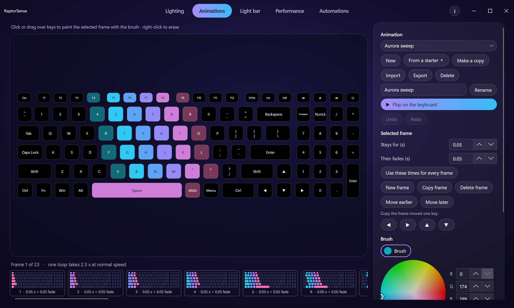

<div align="center">

# RaptorSense

**A free, open-source alternative to PredatorSense for Acer Predator laptops.**<br>
Per-key RGB with your own animations, music and typing effects, plus fan and power control.

[](https://github.com/aaronparayil/RaptorSense/releases/latest)
[](https://github.com/aaronparayil/RaptorSense/releases)
[](LICENSE)


[**Download**](https://github.com/aaronparayil/RaptorSense/releases/latest) ·
[Will it work on my laptop?](#will-it-work-on-my-laptop) ·
[Install](#install) ·
[Features](#features) ·
[Privacy](#privacy) ·
[Build from source](#build-from-source)


</div>

> Unofficial. Not affiliated with or endorsed by Acer. "Predator" and "PredatorSense" are Acer trademarks,
> used here only to describe compatibility.

Created by [aaronparayil](https://github.com/aaronparayil). Free and open source, forever.

## What you get

- **Lighting that follows the real keys.** 20 animated and static effects, 2 that move to your music and 11 that react
  to typing, all drawn on a live preview of your keyboard at 60 fps. Paint single keys by hand, pick two colours or
  let it run a rainbow.
- **Your own animations.** Paint frames, set how long each one stays and fades, and play the loop on the keyboard.
  Start from a ready-made one, undo freely, and share animations as files. An animation can follow your music too:
  step on the beat, speed up when it gets loud, or pulse with the bass.
- **Fans and power.** Power profiles, fan speeds (Auto, Max or your own), live temperatures, the rear light bar,
  and battery cycles and health.
- **Automations.** Rules such as "while this game is open, use my gaming profile, Turbo and Max fans", which put
  everything back when they end.
- **Light on the laptop.** No admin rights for lighting, no accounts, no telemetry. It sits in the tray and stops
  drawing its window while that is closed.

## See it in action


Recorded on an earlier version: the effects are the same, the window has a new look since.

## Will it work on my laptop?

Tested on one machine so far: **Predator Helios 16 PH16-71**, BIOS V1.18, keyboard `04F2:0117`. Windows only for now;
Linux is planned.

- **Lighting** looks for keyboards `04F2:0117`, `011A` and `0119`. If yours isn't one of these, the app says
  "Keyboard not found" and does nothing. A similar keyboard may have its keys mapped differently.
- **Fans and power** use Acer's gaming firmware interface. **On any other model these are untested.** Firmware
  differs between laptops, so watch your temperatures, and use them at your own risk.

RaptorSense comes with no warranty (see the [licence](LICENSE)). If you try it on another model, please
[open an issue](https://github.com/aaronparayil/RaptorSense/issues) and say how it went, whether it worked or not.
The [probe](#other-laptops) helps add new models.

## Install

1. Download the zip from [Releases](https://github.com/aaronparayil/RaptorSense/releases/latest). You don't need to install .NET.
2. Extract it to a folder you'll keep, such as `Documents\RaptorSense`.
3. Run `RaptorSense.exe`. Close PredatorSense first, because both try to drive the keyboard.

The download isn't code-signed, so Windows may show "Windows protected your PC". Choose **More info**, then **Run anyway**.
If you'd rather not trust a download, [build it yourself](#build-from-source).

**For fan and power control**, double-click `Install fan control.cmd` once and accept the administrator prompt.
Lighting works without this. See [Fans and power modes](#fans-and-power-modes) for what it installs.

**To update:** quit RaptorSense from the tray, then extract the new zip over your old folder. Your profiles,
animations and rules are kept. Coming from 1.2 or later, you don't need to install fan control again.

**To uninstall:**

1. If you installed fan control, double-click `Remove fan control.cmd`.
2. Turn off **Start with Windows** in the app if you turned it on.
3. Quit from the tray and delete the folder. Your profiles are in `%APPDATA%\RaptorSense`; delete that too if you don't want them.

## Features

| Feature | State |
|---|---|
| Per-key RGB at 60 fps, no admin rights | Works |
| 20 lighting effects using real key positions, with two colours or Auto rainbow: static, gradient, breathing, rainbow wave, neon, snake, radar, aurora, matrix rain, fire, lightning and more | Works |
| 2 music effects: spectrum and bass pulse (listens to your PC's audio output, never the microphone) | Works |
| 11 typing effects: reactive keys, ripple, lightning, fireball, comet, burst, splash, crosshair, heatmap, confetti, sparkle | Works |
| Typing overlay: layer a typing effect over another effect, such as lightning on key presses over Aurora | Works |
| The keyboard's 13 built-in effects, which keep running when RaptorSense is closed | Works |
| Key painting: click or drag keys in the preview, right-click to erase | Works |
| Animation builder: paint frames, set how long each stays and fades, and play your own key animations. Starter animations, undo, and import/export to share them | Works |
| Animations that follow the music: one frame per beat, faster when it's louder, or brighter with the bass | Works |
| Colour wheel with saved swatches and an eyedropper | Works |
| Profiles: save, load, delete; the app restores your last setup | Works |
| Live preview of the real key layout | Works |
| A choice of nine background colours for the window | Works |
| Tray icon: runs in the background, with profiles, pause and quit | Works |
| Start with Windows (no admin needed), starts hidden with your last setup | Works |
| Power profiles, fans (Auto / Max / Custom) and live temperatures | Works; needs fan control installed |
| Rear light bar: a colour per zone, brightness, and its 6 built-in animations | Works; needs fan control installed. No live effects or music sync on it yet |
| Battery: charge cycles and health, from Windows' battery driver | Works |
| Automations: when an app is open, or on battery or plugged in, switch the lighting profile, power mode and fans, then put them back | Works; power mode and fans need fan control installed |
| PREDATOR key | Planned |
| Linux | Planned |

## Lighting

The **Lighting** tab is the one in the picture at the top. The keyboard in the middle shows what the real one is
doing, and the name of the effect is above it.

- Pick an effect from the list on the right. A ♪ marks the ones that follow your music, a ⌨ the ones that react to typing.
- **Colours** has two colours, a wheel, saved swatches and an eyedropper that takes a colour from any key in the preview.
  Colour 1 is also the paint brush: click or drag over keys to paint them, right-click to erase.
- **Adjust** has speed, brightness and the typing overlay, which draws a typing effect on top of any other effect.
- **Profiles** save the effect, colours, speed, brightness and light bar under a name. The app also restores your
  last setup when it starts.

The round **i** button at the top right opens a small panel with the keyboard connection, the frame rates, a choice
of background colours for the window, and the version. Profiles are readable JSON files in
`%APPDATA%\RaptorSense\profiles`. Painted keys are stored by name (`"W": "FF0000"`), so profiles can be shared and
edited by hand.

Acer's lighting service, PredatorSense and Razer Chroma can also drive the keyboard. RaptorSense re-sends its
frame every second, so it wins, but close PredatorSense while you use it.

## Animations



The **Animations** tab builds your own key animations. An animation is a row of frames: paint each one on the
keyboard, then set how long it stays and how long it takes to fade into the next. The last frame fades back into
the first, so it loops.

- While you edit, the keyboard shows the frame you're painting. **Play on the keyboard** runs the whole loop.
- **With music** makes the animation follow whatever the laptop is playing. **Step on the beat** moves one frame on
  every beat of the bass, so "Stays for" isn't used and "Then fades" is how long each change takes. **Faster when
  louder** plays the loop slowly when it's quiet and speeds it up with the music. **Pulse with the bass** keeps the
  animation's own times and makes it brighter with the bass. The choice is saved in the animation, so it travels
  with an exported file. RaptorSense listens to your PC's audio output, never the microphone, and only while a
  music effect or such an animation is in use.
- The arrow buttons copy the frame moved one key left, right, up or down. Paint a column once and press ▶ a few
  times to make it slide across the keyboard.
- **From a starter** gives you a ready-made animation in the brush colour (sweep, pulse, ripple, waterfall or
  rainbow drift) to change into your own. **Use the keyboard's current lighting** copies what the keyboard shows
  right now into the frame.
- **Undo** and **Redo** (Ctrl+Z, Ctrl+Y) step back through your changes. A whole drag of the brush is one step.
- **Export** saves an animation as a file to share, and **Import** adds files other people shared. An import never
  replaces an animation you already have: one with the same name gets a number.
- Every change saves by itself. Pick **Your animation** on the Lighting tab to use one any time; the speed and
  brightness there apply to it, a typing overlay plays on top, and a saved profile remembers which animation it uses.
- Playing costs about as much as a painted layout: one blend of 128 colours per frame, and nothing is sent to the
  keyboard while a frame holds still.

Animations are readable JSON files in `%APPDATA%\RaptorSense\animations`, with keys stored by name like profiles.
They hold only colours and times (plus one word, `beat`, `speed` or `pulse`, if the animation follows the music),
never code, so a shared animation can't do anything else. On import, anything
RaptorSense doesn't recognise is dropped.

## Automations

The **Automations** tab holds rules such as "while VALORANT is open, use my gaming profile, Turbo and Max fans" or
"on battery, use Eco and a dim profile".

- When a rule ends, everything goes back to how it was before it started, including anything you changed by hand in between.
- If two rules set the same thing, the higher one in the list wins. Each setting is decided on its own, so a lower rule can still set what the higher one leaves alone.
- An app counts as open from when it is running until it closes, so switching to another window doesn't end the rule.
- Quitting RaptorSense also ends the rules and puts the power mode and fans back. If it crashes, or Windows shuts down before that finishes, they can stay as the rule set them.
- The fan safety rules still apply: everything goes through the helper.

Rules are saved in `%APPDATA%\RaptorSense\automations.json`.

## Fans and power modes

Windows lets only administrators change fans, power profiles and the rear light bar, so these go through a small
helper service, `RaptorSense.Helper`. The app itself runs without admin rights and talks to the helper over a local pipe.
The helper accepts only a fixed set of commands (read sensors, set a power profile, set the fan mode, set the light bar),
never arbitrary firmware calls.

The service runs as SYSTEM and starts with Windows. Installing it copies it to `C:\Program Files\RaptorSense\Helper`,
where only administrators can change it. Install again to update it to a newer version.

Safety rules, enforced by the helper (tests in `tests/RaptorSense.Tests`):

- Custom fan speeds are at least 25 %.
- At 90 °C in custom mode the fans go to Max until everything is below 80 °C.
- If the sensors can't be read in custom mode, the fans go to Max.
- When the helper stops, the fans go back to Auto. After a crash, it resets leftover custom speeds on its next start.
- Power profiles are limited to the ones the firmware reports, and every change is read back.

## Command line

The download includes `cli\raptorsense.exe`:

```
raptorsense list
raptorsense run rainbow
raptorsense run spectrum --color 00AEC7 --color2 FF0080
raptorsense builtin wave
raptorsense profile "WASD gaming"
raptorsense animations
raptorsense animation "My sweep" --speed 1.5
raptorsense battery
raptorsense thermal
raptorsense power turbo
raptorsense fans custom 60 70
raptorsense fans auto
raptorsense lightbar FF0000
raptorsense lightbar FF0000 00FF00 0000FF --brightness 60
raptorsense lightbar wave --color 00AEC7
raptorsense lightbar off
```

The `thermal`, `power`, `fans` and `lightbar` commands need fan control installed. `lightbar` takes one colour for
the whole bar or three (left, centre, right), or an animation: breathing, neon, rainbow, wave, ripple or scanner.

## Privacy

RaptorSense has no accounts or telemetry, and sends nothing anywhere.

Typing effects need a Windows keyboard hook. RaptorSense uses it only to learn **which key position** was
pressed: it reads the physical scan code, turns it into a lighting cell, and passes the key on untouched. It never
looks at characters and never records or stores anything. The hook exists only while a typing effect is selected.
See `src/RaptorSense.Core/Input/WindowsKeyHook.cs`.

Music effects, and animations set to follow the music, read the audio your PC is playing to measure its loudness
per frequency. Nothing is recorded, and it stops listening when no such effect is in use.

Automations that name an app need to know which program is in front. RaptorSense reads only the program's name, compares
it with your rules and forgets it. It doesn't read window titles, or keep a list of what you run. This watching exists only
while such a rule is switched on. See `src/RaptorSense.Core/Automation/ForegroundAppWatcher.cs`.

## Build from source

Needs the [.NET 10 SDK](https://dotnet.microsoft.com/download).

```
dotnet build RaptorSense.slnx
dotnet run --project src/RaptorSense.App
dotnet test --project tests/RaptorSense.Tests
```

To use fan control from a source build, run this from an **administrator** terminal:

```
src\RaptorSense.Helper\bin\Debug\net10.0-windows\RaptorSense.Helper.exe install
```

`RaptorSense.Helper.exe uninstall` removes it. To try the helper without installing, run `RaptorSense.Helper.exe` in an
administrator terminal and keep it open.

To build the download zip: `powershell -ExecutionPolicy Bypass -File scripts\package.ps1`

| Path | What |
|---|---|
| `src/RaptorSense.Core` | Keyboard protocol, HID transport, key map, effects engine, audio analysis, fan safety rules |
| `src/RaptorSense.App` | Avalonia desktop app |
| `src/RaptorSense.Cli` | `raptorsense` command-line tool |
| `src/RaptorSense.Helper` | Elevated service for fans, power and the light bar |
| `tests/RaptorSense.Tests` | Effect, fan-safety and light bar protocol tests |
| `scripts/` | Packaging, and the hardware probes used to map the laptop (`probe.ps1` is read-only) |
| `docs/protocol.md` | Everything known about the hardware, with confidence levels |

## Other laptops

If you have a different Predator or Nitro model, the probe helps us add it:

```
powershell -ExecutionPolicy Bypass -File scripts\probe.ps1 -Label mymodel
```

Run it from an administrator PowerShell. It only reads from the firmware and saves a JSON report to `reports\`.
Check the report before sharing it, then open an issue and attach it.

## Licence

RaptorSense is free software under the [GNU General Public License v3.0 or later](LICENSE). You may use, study,
share and change it. If you distribute it or a modified version, you must give out the full source
under the same licence and keep the author credits. That keeps RaptorSense and every fork of it open and free.

## Credits

Created by [aaronparayil](https://github.com/aaronparayil).

The keyboard protocol and key map come from [TrueSense](https://github.com/Order52/truesense) (MIT),
which mapped this keyboard on the same model and BIOS. See [THIRD_PARTY_NOTICES.md](THIRD_PARTY_NOTICES.md)
and the prior-art list in [docs/protocol.md](docs/protocol.md). The download's `licenses` folder lists the
licence of every library it bundles.
