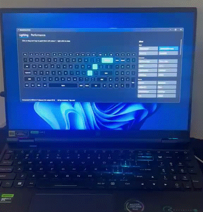
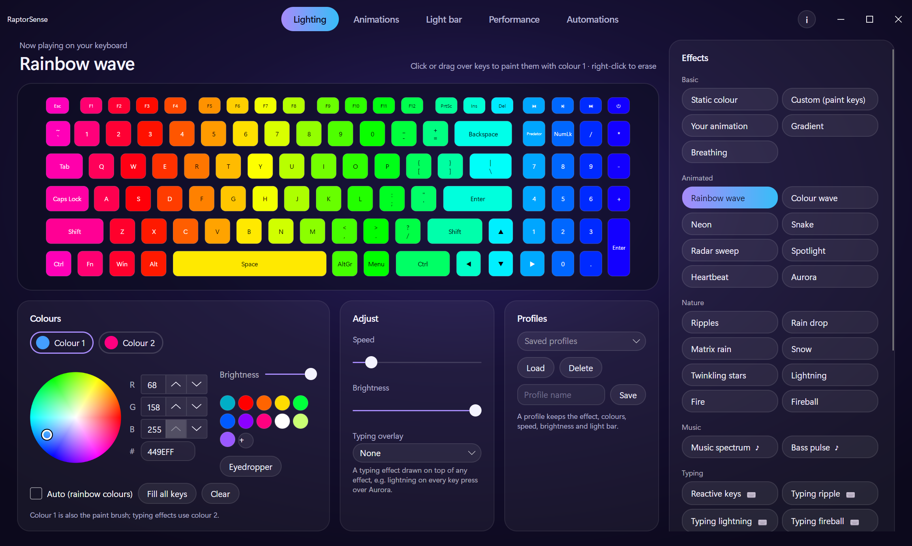

# RaptorSense

A free, open-source alternative to PredatorSense for Acer Predator laptops: **per-key RGB** with custom animations,
music-reactive lighting and typing effects, plus **fan and power control**.

Created by [aaronparayil](https://github.com/aaronparayil). Free and open source, forever.



> Unofficial. Not affiliated with or endorsed by Acer. "Predator" and "PredatorSense" are Acer trademarks,
> used here only to describe compatibility.

## Will it work on my laptop?

Tested on one machine so far: **Predator Helios 16 PH16-71**, BIOS V1.18, keyboard `04F2:0117`. Windows only for now;
Linux is planned.

- **Lighting** looks for keyboards `04F2:0117`, `011A` and `0119`. If yours isn't one of these, the app says
  "Keyboard not found" and does nothing. A similar keyboard may have its keys mapped differently.
- **Fans and power** use Acer's gaming firmware interface. **On any other model these are untested.** Firmware
  differs between laptops, so watch your temperatures, and use them at your own risk.

RaptorSense comes with no warranty (see the [licence](LICENSE)). If you try it on another model, please
[open an issue](https://github.com/aaronparayil/RaptorSense/issues) and say how it went, whether it worked or not.

## Install

1. Download the zip from [Releases](https://github.com/aaronparayil/RaptorSense/releases). You don't need to install .NET.
2. Extract it to a folder you'll keep, such as `Documents\RaptorSense`.
3. Run `RaptorSense.exe`. Close PredatorSense first, because both try to drive the keyboard.

The download isn't code-signed, so Windows may show "Windows protected your PC". Choose **More info**, then **Run anyway**.
If you'd rather not trust a download, [build it yourself](#build-from-source).

**For fan and power control**, double-click `Install fan control.cmd` once and accept the administrator prompt.
Lighting works without this. See [Fans and power modes](#fans-and-power-modes) for what it installs.

**To uninstall:**

1. If you installed fan control, double-click `Remove fan control.cmd`.
2. Turn off **Start with Windows** in the app if you turned it on.
3. Quit from the tray and delete the folder. Your profiles are in `%APPDATA%\RaptorSense`; delete that too if you don't want them.

## Features



| Feature | State |
|---|---|
| Per-key RGB at 60 fps, no admin rights | Works |
| 20 lighting effects using real key positions, with two colours or Auto rainbow: static, gradient, breathing, rainbow wave, neon, snake, radar, aurora, matrix rain, fire, lightning and more | Works |
| 2 music effects: spectrum and bass pulse (listens to your PC's audio output, never the microphone) | Works |
| 11 typing effects: reactive keys, ripple, lightning, fireball, comet, burst, splash, crosshair, heatmap, confetti, sparkle | Works |
| Typing overlay: layer a typing effect over another effect, such as lightning on key presses over Aurora | Works |
| The keyboard's 13 built-in effects, which keep running when RaptorSense is closed | Works |
| Key painting: click or drag keys in the preview, right-click to erase | Works |
| Colour wheel with saved swatches and an eyedropper | Works |
| Profiles: save, load, delete; the app restores your last setup | Works |
| Live preview of the real key layout | Works |
| Tray icon: runs in the background, with profiles, pause and quit | Works |
| Start with Windows (no admin needed), starts hidden with your last setup | Works |
| Power profiles, fans (Auto / Max / Custom) and live temperatures | Works; needs fan control installed |
| Rear light bar: a colour per zone, brightness, and its 6 built-in animations | Works; needs fan control installed. No live effects or music sync on it yet |
| Battery: charge cycles and health, from Windows' battery driver | Works |
| PREDATOR key | Planned |
| Linux | Planned |

Profiles are readable JSON files in `%APPDATA%\RaptorSense\profiles`. Painted keys are stored by name
(`"W": "FF0000"`), so profiles can be shared and edited by hand.

Acer's lighting service, PredatorSense and Razer Chroma can also drive the keyboard. RaptorSense re-sends its
frame every second, so it wins, but close PredatorSense while you use it.

## Fans and power modes

Windows lets only administrators change fans, power profiles and the rear light bar, so these go through a small
helper service, `RaptorSense.Helper`. The app itself runs without admin rights and talks to the helper over a local pipe.
The helper accepts only a fixed set of commands (read sensors, set a power profile, set the fan mode, set the light bar),
never arbitrary firmware calls.

The service runs as SYSTEM and starts with Windows. Installing it copies it to `C:\Program Files\RaptorSense\Helper`,
where only administrators can change it. Install again to update it to a newer version.

Safety rules, enforced by the helper (tests in `tests/RaptorSense.Tests`):

- Custom fan speeds are at least 25 %.
- At 90 °C in custom mode the fans go to Max until everything is below 80 °C.
- If the sensors can't be read in custom mode, the fans go to Max.
- When the helper stops, the fans go back to Auto. After a crash, it resets leftover custom speeds on its next start.
- Power profiles are limited to the ones the firmware reports, and every change is read back.

## Command line

The download includes `cli\raptorsense.exe`:

```
raptorsense list
raptorsense run rainbow
raptorsense run spectrum --color 00AEC7 --color2 FF0080
raptorsense builtin wave
raptorsense profile "WASD gaming"
raptorsense battery
raptorsense thermal
raptorsense power turbo
raptorsense fans custom 60 70
raptorsense fans auto
raptorsense lightbar FF0000
raptorsense lightbar FF0000 00FF00 0000FF --brightness 60
raptorsense lightbar wave --color 00AEC7
raptorsense lightbar off
```

The `thermal`, `power`, `fans` and `lightbar` commands need fan control installed. `lightbar` takes one colour for
the whole bar or three (left, centre, right), or an animation: breathing, neon, rainbow, wave, ripple or scanner.

## Privacy

RaptorSense has no accounts or telemetry, and sends nothing anywhere.

Typing effects need a Windows keyboard hook. RaptorSense uses it only to learn **which key position** was
pressed: it reads the physical scan code, turns it into a lighting cell, and passes the key on untouched. It never
looks at characters and never records or stores anything. The hook exists only while a typing effect is selected.
See `src/RaptorSense.Core/Input/WindowsKeyHook.cs`.

Music effects read the audio your PC is playing to measure its loudness per frequency. Nothing is recorded.

## Build from source

Needs the [.NET 10 SDK](https://dotnet.microsoft.com/download).

```
dotnet build RaptorSense.slnx
dotnet run --project src/RaptorSense.App
dotnet test --project tests/RaptorSense.Tests
```

To use fan control from a source build, run this from an **administrator** terminal:

```
src\RaptorSense.Helper\bin\Debug\net10.0-windows\RaptorSense.Helper.exe install
```

`RaptorSense.Helper.exe uninstall` removes it. To try the helper without installing, run `RaptorSense.Helper.exe` in an
administrator terminal and keep it open.

To build the download zip: `powershell -ExecutionPolicy Bypass -File scripts\package.ps1`

| Path | What |
|---|---|
| `src/RaptorSense.Core` | Keyboard protocol, HID transport, key map, effects engine, audio analysis, fan safety rules |
| `src/RaptorSense.App` | Avalonia desktop app |
| `src/RaptorSense.Cli` | `raptorsense` command-line tool |
| `src/RaptorSense.Helper` | Elevated service for fans, power and the light bar |
| `tests/RaptorSense.Tests` | Effect, fan-safety and light bar protocol tests |
| `scripts/` | Packaging, and the hardware probes used to map the laptop (`probe.ps1` is read-only) |
| `docs/protocol.md` | Everything known about the hardware, with confidence levels |

## Other laptops

If you have a different Predator or Nitro model, the probe helps us add it:

```
powershell -ExecutionPolicy Bypass -File scripts\probe.ps1 -Label mymodel
```

Run it from an administrator PowerShell. It only reads from the firmware and saves a JSON report to `reports\`.
Check the report before sharing it, then open an issue and attach it.

## Licence

RaptorSense is free software under the [GNU General Public License v3.0 or later](LICENSE). You may use, study,
share and change it. If you distribute it or a modified version, you must give out the full source
under the same licence and keep the author credits. That keeps RaptorSense and every fork of it open and free.

## Credits

Created by [aaronparayil](https://github.com/aaronparayil).

The keyboard protocol and key map come from [TrueSense](https://github.com/Order52/truesense) (MIT),
which mapped this keyboard on the same model and BIOS. See [THIRD_PARTY_NOTICES.md](THIRD_PARTY_NOTICES.md)
and the prior-art list in [docs/protocol.md](docs/protocol.md). The download's `licenses` folder lists the
licence of every library it bundles.
